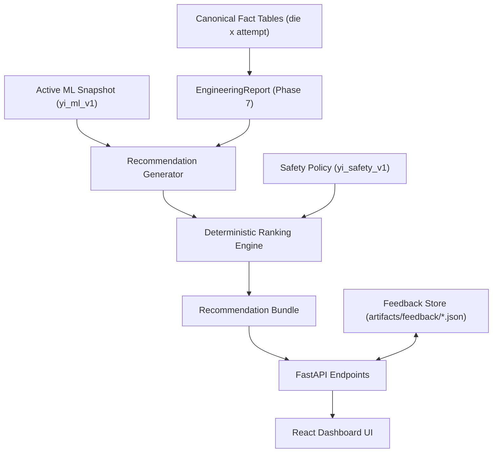
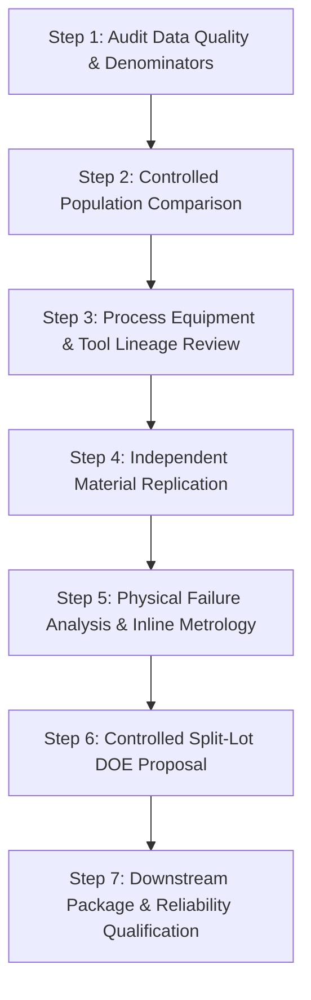
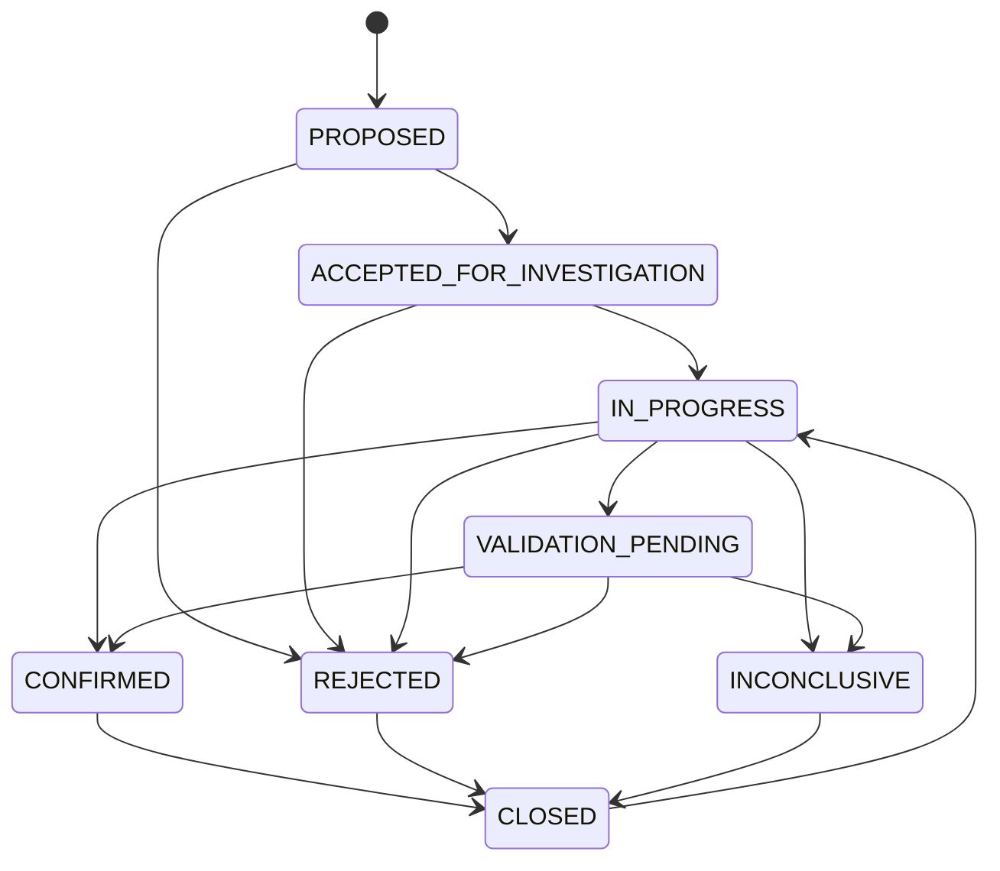

# Evidence-Backed Engineering Recommendation Engine

## 1. Purpose and Scope

The **Evidence-Backed Engineering Recommendation Engine** converts statistical detector results, engineering hypotheses, opportunity analysis, and ML evidence from the Yield Improvement Agent into a prioritized, actionable engineering investigation plan.

The engine answers three core questions for semiconductor process and test engineers:
1. **Where is first-pass yield being lost?** (Exact counts, affected slice denominators, baseline comparison)
2. **What should the engineering team investigate first, and why?** (Deterministic, transparent prioritization)
3. **How should the team validate whether the suspected issue is real and whether an authorized corrective action improves yield?** (A structured 7-step engineering validation protocol)

### Strictly Advisory Guardrails
The engine is strictly diagnostic and advisory:
- `production_action: "FORBIDDEN"` (immutable)
- `production_authorized: false` (immutable)
- `safety_eligible_production: 0.0` (immutable)
- Automated writes or relaxations of ATE limits, tool recipes, and equipment parameters are strictly prohibited.
- Statistical associations are never labeled as proven root causes.
- Upper-bound opportunities are never presented as guaranteed yield recovery.

---

## 2. Reused Architecture & Integration Points

The engine integrates directly into the existing Yield Improvement Agent architecture without modifying canonical analytical contracts, source datasets, or champion models:

```text
Canonical Data (yi_synthetic_v2) 
  → Phase 1 FPY & Pareto Engine
  → Phase 3 Statistical Detectors (Lot, Wafer, Spatial, Parametric, Near-Limit)
  → Phase 4 Hypothesis Composer (UNCONFIRMED)
  → Phase 5 Opportunity Engine (Upper Bound & Plausible Excess)
  → Phase 6 Validation Engine (Safety Gates S0–S12)
  → EngineeringReport
      ↓
RECOMMENDATION ENGINE (src/yield_improvement/recommendations/)
  ├── generator.py (Derives recommendations from report & ML snapshot)
  ├── ranking.py (Deterministic policy-based priority & confidence)
  ├── contracts.py (Pydantic schemas with strict safety invariants)
  └── storage.py (Isolated feedback state machine in artifacts/feedback/)
      ↓
API & DASHBOARD LAYER
  ├── FastAPI Routes (/api/datasets/{id}/recommendations[/{rec_id}/feedback])
  └── React Frontend (RankedRecommendations component in DashboardView)
```

---

## 3. Data Flow & Lineage



---

## 4. Recommendation Schemas

The recommendation engine defines typed, immutable Pydantic models in `src/yield_improvement/recommendations/contracts.py`:

### `EngineeringRecommendation`
- **Identification:** `recommendation_id`, `hypothesis_id`, `title`, `recommendation_category`, `status`.
- **Priority & Ranking:** `priority_rank`, `priority_tier` (`HIGH`, `MEDIUM`, `LOW`), `confidence_tier` (`HIGH`, `MODERATE`, `LOW`, `INSUFFICIENT`), `ranking_score`, `ranking_rationale`.
- **Evidence:** `observed_pattern`, `target_population`, `affected_die_count`, `eligible_die_count`, `observed_failure_rate`, `baseline_failure_rate`, `supporting_detectors`, `hypothesis_confidence`, `ml_evidence_status`, `ml_evidence_notes`, `missing_evidence`, `limitations`.
- **Concrete Action & Reason:** `recommended_action`, `reason`, `expected_information`, `validation_method`, `success_criteria`, `required_data`, `risk_if_ignored`, `next_step_if_confirmed`, `next_step_if_rejected`.
- **Validation Protocol:** `validation_protocol` (`ValidationProtocol` containing 7 structured steps).
- **Opportunity:** `observed_loss_rate`, `upper_bound_rate`, `upper_bound_count`, `plausible_rate`, `plausible_count`, `safety_eligible_production_rate: 0.0`, `opportunity_disclaimer`.
- **Safety Invariants:** `production_action: "FORBIDDEN"`, `production_authorized: False`, `not_a_root_cause: True`, `safety_statement`.

### Categories Supported
- `Lot investigation`
- `Wafer investigation`
- `Spatial investigation`
- `Parametric investigation`
- `Equipment investigation`
- `Environmental investigation`
- `Test measurement/repeatability investigation`
- `Near-limit investigation`
- `Data-quality investigation`

---

## 5. Deterministic Ranking Formula

Ranking is policy-driven, deterministic, and fully documented:

$$\text{Score} = W_{\text{assoc}} + S_{\text{evidence}} + S_{\text{action}} + S_{\text{opp}}$$

### 1. Safety Gate
If `production_action != "FORBIDDEN"` or `production_authorized != False` or `safety_eligible_production != 0.0`, the recommendation is disqualified (Score = 0.0).

### 2. Evidence Association Class Weight ($W_{\text{assoc}} \in [0.05, 0.50]$)
- `PRIMARY_EVIDENCE`: Base = $0.50$
- `SECONDARY_ASSOCIATION`: Base = $0.30$
- `WEAK_ASSOCIATION`: Base = $0.20$
- `INSUFFICIENT_EVIDENCE`: Base = $0.05$ (capped at max score 0.20)

### 3. Evidence Quality & Multi-Domain Independence ($S_{\text{evidence}} \in [0.0, 0.25]$)
- Multi-domain detector support (distinct analytical families, e.g. process + spatial): $+0.12$. Correlated or single-detector observation: $+0.04$.
- Data completeness / gap penalty: $+0.08$ for zero critical gaps, $+0.04$ for $\le 2$ optional gaps.
- Population coverage ratio: $\min(1.0, N_{\text{pop}} / N_{\text{eligible}}) \times 0.05$.

### 4. Actionability & Systematic Loss Relevance ($S_{\text{action}} \in [0.0, 0.20]$)
- Systematic excess rate: $\min(0.12, (\text{fail\_rate} - \text{baseline}) \times 0.6)$.
- Concrete, testable action specification: $+0.08$.

### 5. Opportunity Context ($S_{\text{opp}} \in [0.0, 0.05]$)
- Plausible excess rate contribution is strictly capped at $0.05$. A high theoretical opportunity cannot override weak or conflicting evidence.

### Stable Tie-Breaking
1. `ranking_score` (descending)
2. `hypothesis_id` (alphabetical ascending)
3. `recommendation_id` (alphabetical ascending)

---

## 6. Distinction Between Priority, Confidence, and Opportunity

| Dimension | Meaning | Metric in UI |
| :--- | :--- | :--- |
| **Priority** | Execution order for the engineering team based on addressable loss and actionability. | `Rank #1`, `Priority: HIGH / MEDIUM / LOW` |
| **Confidence** | Statistical certainty and completeness of the supporting data. | `Confidence: HIGH / MODERATE / LOW / INSUFFICIENT` |
| **Opportunity** | Diagnostic upper bound and plausible excess rate for the affected population. | `Upper Bound: 3.88%`, `Plausible: 2.32%` (non-additive) |

A high-priority investigation does not imply a proven root cause or a guaranteed high yield recovery.

---

## 7. Honest ML Evidence Policy

Leave-One-Lot-Out (LOLO) experiments on the synthetic V2 dataset demonstrated that the logistic model did not establish generalizable predictive performance (pooled ROC-AUC = 0.4592, below random baseline).

Therefore, for the V2 dataset:
- `ml_evidence_status` is explicitly reported as `"NEEDS_MORE_DATA"`.
- The UI explicitly explains that ML evidence is insufficient on this dataset and that prioritization is driven purely by verified statistical and domain evidence.
- The active champion model `yi_ml_v1` is maintained strictly unchanged (hashes verified).
- No models were retrained, modified, or activated.

---

## 8. 7-Step Validation Protocol

Every recommendation includes a structured `ValidationProtocol`:



Each step specifies:
- `investigation_action`
- `required_evidence`
- `expected_measurement`
- `acceptance_criteria`
- `rejection_criteria`
- `limitations_and_safety`

---

## 9. Investigation Feedback Lifecycle & State Machine

Engineering feedback is stored in isolated JSON files (`artifacts/feedback/{dataset_id}_feedback.json`), preventing mutation of canonical data.

### State Transitions


- Moving to `CONFIRMED` requires an explicit `investigation_conclusion`.
- Atomic writes (`.tmp` file replace) prevent corrupted files.
- Thread-safe writing prevents race conditions.
- Strict regex and traversal checks prevent directory traversal attacks.

---

## 10. API Specifications

### 1. `GET /api/datasets/{dataset_id}/recommendations`
Returns the ranked `RecommendationBundle` with active feedback statuses overlaid.
Supports optional `?lot_id=L004` query parameter.

### 2. `GET /api/datasets/{dataset_id}/recommendations/{recommendation_id}`
Returns complete details for a single recommendation.

### 3. `POST /api/datasets/{dataset_id}/recommendations/{recommendation_id}/feedback`
Records engineer disposition, notes, and conclusion. Validates state transition.
Returns updated `FeedbackRecord` with `200 OK` (or `400 Bad Request` if invalid transition).

### 4. `GET /api/datasets/{dataset_id}/recommendations/{recommendation_id}/feedback`
Returns complete chronological audit history for that recommendation.

---

## 11. Canonical V2 Findings & Example Recommendations

Verified against current canonical V2 data:
- **Denominator:** 2,500 eligible dies (2,249 passes, 251 failures, 10.04% FPY loss).
- **Generated Recommendations:**
  1. `REC-PROCESS.LOT_VARIATION`: LOT 004 (500 dies, 97 fails, 19.4% rate vs 10.0% baseline). Rank #1, Priority: HIGH, Confidence: HIGH.
  2. `REC-SPATIAL.BORDER`: Border zone (900 dies, 118 fails, 13.11% rate vs 8.31% inner baseline). Rank #2, Priority: HIGH, Confidence: HIGH.
  3. `REC-PARAMETRIC.SHIFT`: VMIN:L004 distribution shift. Rank #3, Priority: MEDIUM, Confidence: MODERATE.
  4. `REC-PROCESS.WAFER_VARIATION`: L004/W05 (100 dies, 45 fails, 45.0% rate). Rank #4, Priority: MEDIUM, Confidence: MODERATE.
  5. `REC-TEST.LIMIT_SENSITIVITY`: Near-limit population (299 dies, 67 fails, 22.41% rate). Priority: LOW, Confidence: MODERATE. Explicitly cautions: *Do not relax test limits*.

---

## 12. Verification and Test Results

- **Unit Tests:** `pytest tests/unit` passed **363 / 363 tests**.
  - `tests/unit/test_recommendation_engine.py`: 6/6 passed.
  - `tests/unit/test_recommendation_feedback.py`: 5/5 passed.
  - `tests/unit/test_api_recommendations.py`: 4/4 passed.
  - All pre-existing API and analytical unit tests passed without regressions.
- **Frontend Vitest:** `npm test` in `frontend/` passed **47 / 47 tests**.
- **Frontend Production Build:** `npm run build` compiled cleanly without TypeScript or Vite errors.
- **Asset Integrity:** Hashes for `artifacts/ml/yi_ml_v1` (`model.pkl`, `metadata.json`, `metrics.json`, `feature_list.json`) verified 100% identical.
